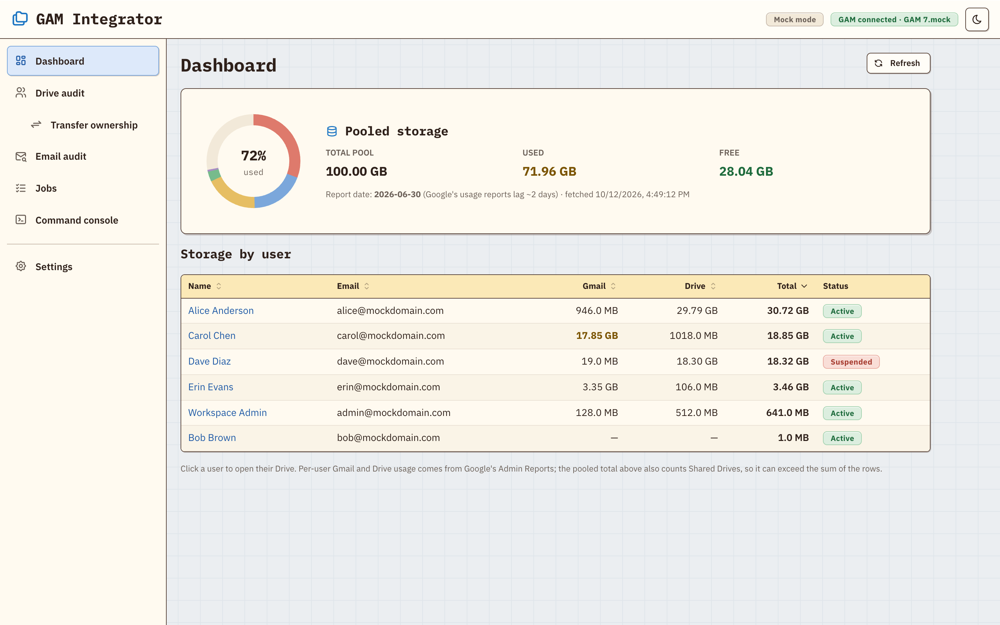
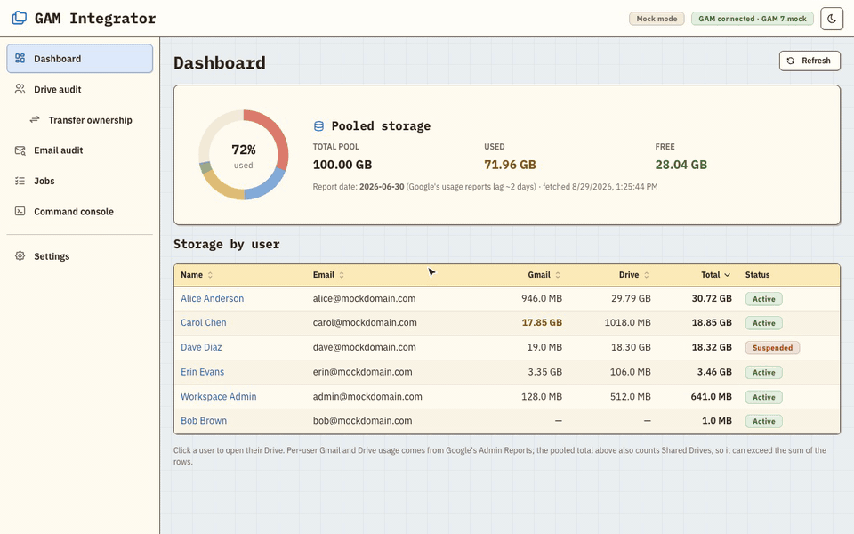
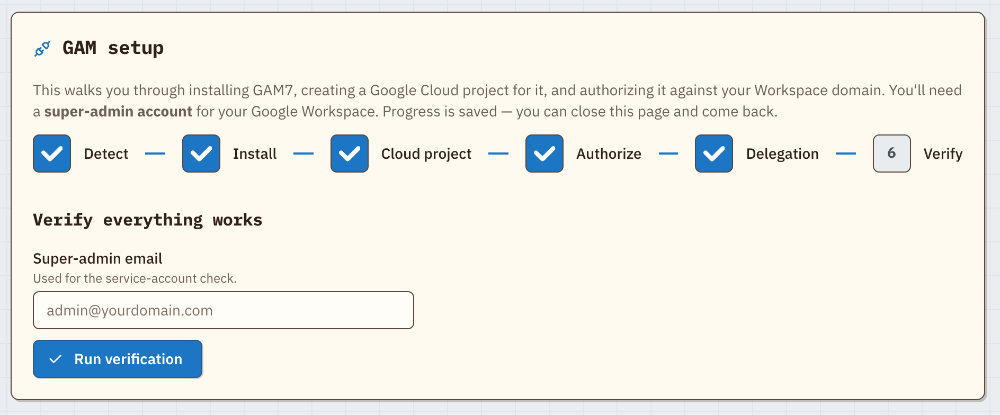
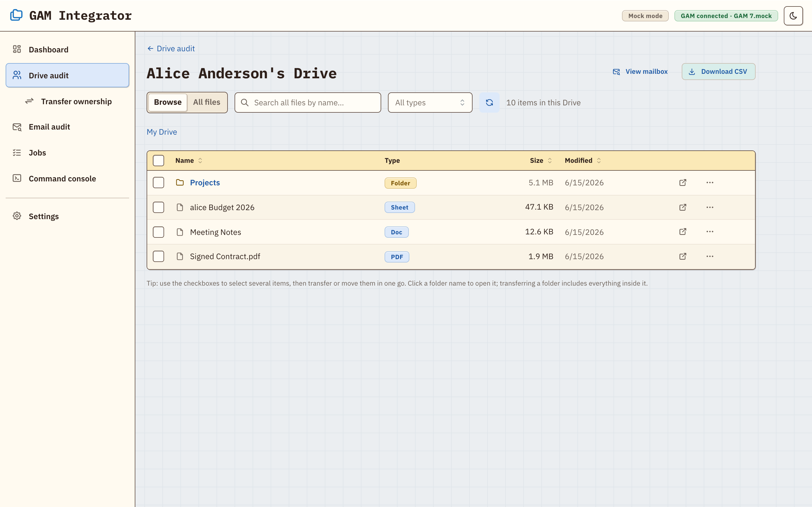

# GAM Integrator: a web GUI for GAM7 and Google Workspace admin

GAM Integrator is a free, open-source web interface for [GAM7](https://github.com/GAM-team/GAM), the command-line tool Google Workspace (formerly G Suite) admins use to manage Drive and Gmail across a whole domain. It runs on your own computer, installs and sets up GAM for you, and turns everyday GAM jobs into point-and-click screens, so you don't need to learn GAM's command syntax. Its main feature fixes a long-standing Google Drive gap: transferring ownership of a folder **and everything inside it**.

**Who it's for:** Google Workspace super admins and IT teams who want GAM's reach without the terminal. Typical jobs: offboarding a departing employee's Drive, auditing storage and sharing across every user, and exporting a user's mailbox.

**Website:** [christian-g-guerrero.github.io/gam-integrator](https://christian-g-guerrero.github.io/gam-integrator/)



<p align="center"><em>Shown in the Pastel Retro skin. Modern and Classic are one click away in Settings, and every skin has a dark mode.</em></p>

## What you can do

- **Transfer ownership of a Google Drive folder, contents included.** In Google Drive, giving a folder a new owner doesn't change who owns the files inside it. Anything a colleague added stays theirs, so a departing employee's "transferred" folder is often still full of other people's files. GAM Integrator walks the entire folder tree and transfers every item to the new owner, whoever owns it now. A deep scan also finds files that were never shared with you. You see a dry-run preview first (item counts per current owner), confirm a folder transfer by typing the folder's name, and watch live progress you can cancel.
- **Set up GAM without the docs.** A guided wizard installs GAM7 (or finds your existing GAM7 or GAMADV-XTD3) and walks you through the Google Cloud project, OAuth, and domain-wide delegation. It explains each step in plain English and shows a live terminal in the browser.
- **Audit Google Drive across the domain.** See storage per user, open any user's Drive, browse folders, search, filter by type, and export to CSV.
- **Manage Drive sharing and permissions.** See who each file is shared with, and add, change, or remove access. Copy or move files within a user's Drive.
- **Audit Gmail.** Browse and search any user's mailbox, search mail across the domain, see a Gmail storage report, and [export a whole mailbox](#exporting-a-mailbox) to JSONL or CSV.
- **Run any GAM command.** The built-in console runs one `gam …` command at a time, and asks you to confirm destructive ones (delete, wipe, trash, …).
- **Pick a look.** Light, dark, or follow your OS, with an accent color and two retro skins: **Classic** (Mac OS Platinum) and **Pastel Retro**. All are under Settings → Appearance.



<p align="center"><em>Transferring a folder and everything inside it, including a file owned by someone else (sample domain).</em></p>

<table>
  <tr>
    <td width="50%">
      
      <p align="center"><em>Guided setup wizard</em></p>
    </td>
    <td width="50%">
      
      <p align="center"><em>Per-user Drive browser</em></p>
    </td>
  </tr>
</table>

## What you need

- **Node.js 20.19+ or 22.12+** ([nodejs.org](https://nodejs.org)).
- **A super-admin account** on your Google Workspace domain.
- **macOS.** Developed and tested on macOS. Linux should work, but it hasn't been tested there yet.

You don't need to install GAM first. The setup wizard does it, or finds the copy you already have.

## Install and run

```bash
git clone https://github.com/christian-g-guerrero/gam-integrator.git
cd gam-integrator
npm install
npm run build
npm start
```

Open **http://127.0.0.1:5199**. On macOS you can double-click `start.command` instead: it installs, builds, starts the app, and opens your browser.

On first launch the app opens **Settings**. Follow the **GAM Setup Wizard** there. You'll sign in to Google and approve access in the Cloud Console when the wizard asks. Once GAM is set up, the rest of the app unlocks.

### Try it first, with no Workspace

```bash
npm run dev:mock
```

Then open **http://localhost:5173**. This runs against a fake domain (`mockdomain.com`) with sample users, files, and mail. Every feature works, and nothing talks to Google.

## Exporting a mailbox

Export any user's Gmail mailbox as an admin, for offboarding, archiving, or importing into another system.

**Email audit → Browse mailbox → Export mailbox** saves a whole mailbox as one download. Tick **Include Spam & Trash** first if you want those too.

| Format | You get |
| --- | --- |
| **JSONL archive (ZIP)**, recommended | `mailbox.jsonl` (one message per line) + `manifest.json` |
| **JSONL + attachments (ZIP)** | the same, plus every attachment |
| **CSV** | one spreadsheet row per message. Easy to open, but **not lossless** |
| **CSV + attachments (ZIP)** | the CSV, the attachments, and a file mapping each attachment to its message |

The JSONL archive is built from each message's original source, so bodies and headers are exact. Check the downloaded file with `npm run verify-export -w server -- <zip>`. Field reference for importers: [`docs/mailbox-export-schema.md`](docs/mailbox-export-schema.md).

## Security

With GAM set up, this app has super-admin power over your domain, so it is locked down to your own machine:

- The server listens on **127.0.0.1 only**, so no other machine can reach it. It also rejects requests from other websites (cross-origin and DNS-rebinding attempts).
- GAM runs as a direct program call with fixed arguments, never through a shell. The console accepts only a single `gam` command.
- GAM's credentials stay where GAM keeps them (e.g. `~/GAMConfig`). The app's own data lives in `~/.gam-integrator/`: setup progress, cached stats, job logs (deleted after 30 days), and mailbox exports. **Exports are full copies of mail and are never deleted automatically.** Review and delete them under Settings → Local data.

## Troubleshooting

- **`posix_spawnp failed` when a terminal opens.** Run `npm run postinstall`, which restores an execute permission npm sometimes strips.
- **npm warns about blocked install scripts.** Approve the two native builds once: `npm install-scripts approve node-pty esbuild`.
- **Port already in use.** Set `API_PORT` (the server, default 5199) or `PORT` (the dev UI, default 5173).
- **GAM works in your terminal but the app can't find it.** The app looks in `~/bin/gam7`, `~/bin/gamadv-xtd3`, `~/bin/gam`, `/usr/local/bin`, Homebrew, and your `PATH`. Symlink your copy into one of those, e.g. `ln -s /path/to/gam /usr/local/bin/gam`.

## FAQ

**Is there a GUI for GAM?** Yes, this is one. GAM Integrator is a web front end for GAM7 that runs locally. Most tasks are buttons and forms, and a built-in console still runs any `gam` command when you need one.

**How do I transfer ownership of a Google Drive folder and all its files?** In Drive, changing a folder's owner leaves the files inside owned by whoever created them. Use **Transfer** here: pick the folder and the new owner, check the dry-run preview, and every file and subfolder moves to the new owner. See [What you can do](#what-you-can-do).

**Does it work with GAMADV-XTD3?** GAM7 is the current release of GAM and includes what was GAMADV-XTD3. The setup wizard installs GAM7, and it also finds an existing install in `~/bin/gamadv-xtd3`.

**Does my data leave my computer?** Only through GAM's own calls to Google's APIs. The app runs on `127.0.0.1`, has no cloud service of its own, and keeps its cache and exports in `~/.gam-integrator/`. See [Security](#security).

**Can I try it without a Google Workspace account?** Yes. `npm run dev:mock` runs it against a fake domain. See [Try it first](#try-it-first-with-no-workspace).

## Development

| Command | What it does |
| --- | --- |
| `npm run dev` | Server + client with hot reload, against real GAM |
| `npm run dev:mock` | The same, against the mock domain |
| `npm run lint && npm run build` | The check to run before committing |
| `npm test` | Server unit tests |

React + Vite + Mantine client, Express server.

## License

[MIT](LICENSE)
